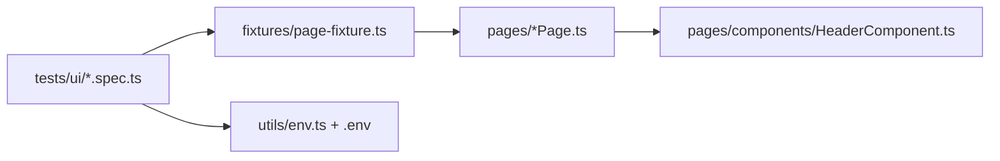

# CybersoftBnb – Airbnb Clone Test Automation

End-to-end test project for the Airbnb clone at https://demo5.cybersoft.edu.vn, built as the final project of the CyberSoft Automation Testing course (class TESTING-16).

- **UI automation:** Playwright + TypeScript with the Page Object Model.
- **API testing:** Postman collection for https://airbnbnew.cybersoft.edu.vn, runnable from the command line with Newman.
- **Test documents:** Test Plan (docx) and Test Cases with execution results (xlsx).

## Team
1. Hứa Vinh Thắng
2. Mohamed Hary

Instructor: Trịnh An Thành.

## Tech stack
| Area | Tool |
|---|---|
| Language | TypeScript (Node.js 22 LTS) |
| UI automation | Playwright Test (`@playwright/test` 1.62) |
| Design pattern | Page Object Model + Playwright fixtures |
| Browser | Chromium (bundled with Playwright) |
| API testing | Postman collection, executed with Newman |
| Reporting | Playwright HTML report (screenshot and video on failure, trace on retry) |
| Test data | `.env` file read with `dotenv` |
| CI | GitHub Actions |

## Deliverables
| Deliverable | Location |
|---|---|
| Automation source code | this repository (`pages/`, `fixtures/`, `tests/`, `utils/`) |
| Test Plan | [docs/AirBnB_Test_Plan.docx](docs/AirBnB_Test_Plan.docx) |
| Test Cases, execution results and Bug Report | [docs/AirBnB_Test_Cases.xlsx](docs/AirBnB_Test_Cases.xlsx) (sheets Module 1-5, API Test, Bug Report) |
| UI test report (last run, 27/28 passed) | [docs/ui-report/index.html](docs/ui-report/index.html), open with `npx playwright show-report docs/ui-report`; a new run writes to `playwright-report/` (`npm run report`) |
| API test resources | [docs/AirBnB_API_Collection.postman_collection.json](docs/AirBnB_API_Collection.postman_collection.json) |
| How to run everything | this README |

## Project structure
```text
CK_Nhom6_AirBNB
├── pages/                  Page Objects (locators + business actions, no assertions)
│   └── components/         Shared parts (header)
├── fixtures/               Page object fixtures and the pre-logged-in fixture (loggedInUser)
├── tests/ui/               UI specs (*.spec.ts)
├── utils/                  env.ts (reads .env), dateHelper.ts (relative dates, price parsing)
├── data/files/             Files used by the avatar upload tests
├── constants/              Timeout constants
├── docs/                   Test Plan, Test Cases, Postman collection
├── .github/workflows/      CI pipeline
├── playwright.config.ts    Playwright configuration
├── tsconfig.json
├── .env.example            Template of the test data and accounts
└── README.md
```



## Test coverage
47 test cases in total: 31 UI and 16 API. The 28 Playwright tests automate 24 of the UI cases, TC_12 is covered indirectly by other specs, and 6 UI cases (TC_01, 13, 14, 18, 24, 25) were run by hand.

| Module (Excel sheet) | Cases | Covers | Spec |
|---|---|---|---|
| Auth - Register, Sign in & Sign out | TC_01 - TC_10 | register (success, duplicate email, required fields, email format), login (valid, invalid), logout from 4 pages | `register`, `login`, `logout` |
| Home & Search | TC_11 - TC_14 | search by location, location cards, date range, number of guests | `home` |
| Room List & Room Detail | TC_15 - TC_18 | room card info, open detail, detail sections, comment | `rooms`, `roomDetail` |
| Booking | TC_19 - TC_25 | book (success, guest, same day), price compare, total price, guest limits | `booking` |
| User Profile | TC_26 - TC_31 | view, update phone and email, avatar upload (valid, invalid), booking history | `profile` |
| API Test | API_01 - API_16 | signin, signup, user, rooms, locations, booking, comments, negative cases | Postman collection |

## Results of the last run
| Suite | Result |
|---|---|
| UI automation (Playwright) | 28 tests: 27 passed, 1 failed (known site bug below) |
| API collection (Newman) | 16 requests: all expected status codes returned; API_06 (avatar upload) needs a file, so it is confirmed through the UI test |
| Test Cases workbook | 47 cases: 46 Pass, 1 Fail |

### Defects found
Logged in the `Bug Report` sheet of the Test Cases workbook.

| # | Summary | Priority |
|---|---|---|
| 1 | Register accepts the email `abc@gmail` (no full domain) and shows no format error (TC_04). | Medium |
| 2 | The profile edit form rejects names with digits or `-` (for example `test16-nhom6`) with "Họ tên không hợp lệ!", although the register form accepts them. | Low |

## Setup (one time)
Requirements: Node.js 18 or later and Git. Run every command from the repository root.

```bash
npm install
npx playwright install chromium
```

Create the `.env` file (Bash: `cp .env.example .env`, PowerShell: `Copy-Item .env.example .env`) and fill in the values:

| Variable | Meaning |
|---|---|
| `BASE_URL` | Site URL, defaults to `https://demo5.cybersoft.edu.vn` |
| `LOGIN_EMAIL`, `LOGIN_PASSWORD` | Valid account used by the login, logout, booking and profile tests |
| `LOGIN_INVALID_EMAIL`, `LOGIN_INVALID_PASSWORD` | Wrong credentials for the failed-login test |
| `REGISTER_NAME`, `REGISTER_PASSWORD`, `REGISTER_PHONE` | Data typed into the register form (the phone is also used by the profile update test) |
| `REGISTER_EXISTING_EMAIL` | Email of **another** user that already exists on the site, different from `LOGIN_EMAIL` |
| `REGISTER_BIRTHDAY` | Format `January 01, 2000` |
| `REGISTER_GENDER` | Text of the gender option in the dropdown: `Nam` or `Nữ` |

`.env` is git-ignored and never committed. The `LOGIN_EMAIL` account needs at least one booking for the booking history test.

> On Windows PowerShell, if `npx` or `npm` is blocked by the execution policy, use `npx.cmd` and `npm.cmd` instead.

## Run UI tests
```bash
npm test                                    # all tests, headless, 4 workers
npm run test:headed                         # with a visible browser
npx playwright test tests/ui/login.spec.ts  # one spec file
npx playwright test -g "total price"        # one test by title
npx playwright test --ui                    # UI mode: step through tests and pick locators
npx playwright test --workers=1             # one test at a time
npm run typecheck                           # TypeScript check
```

Spec files: `login`, `register`, `logout`, `home`, `rooms`, `roomDetail`, `booking`, `profile` in `tests/ui/`.

To also keep a machine-readable result file:
```powershell
$env:PLAYWRIGHT_JSON_OUTPUT_NAME="results.json"; npx.cmd playwright test --reporter=list,json,html
```

## Run API tests
Postman is not required. Newman runs the collection from the command line and uses the account in the collection variables `email` and `password`:

```bash
npx newman run docs/AirBnB_API_Collection.postman_collection.json --reporters cli,json --reporter-json-export api-results.json
```

To use Postman instead, import `docs/AirBnB_API_Collection.postman_collection.json` and run the collection in order (API_01 first, it stores the token). Notes:
- `API_06 Upload Avatar` needs an image selected for the `formFile` field.
- `API_11`, `API_13` and `API_16` write data to the shared demo site (booking and comments).
- The `tokenCybersoft` header is the class-wide token stored in the collection variables.

## Reports
After a run Playwright writes an HTML report to `playwright-report/`:
```bash
npm run report
```
Click a failed test to see the error, steps, screenshot and video. Artifacts of failed tests are in `test-results/`. To always record traces: `npx playwright test --trace on`, then `npx playwright show-trace test-results/<test-folder>/trace.zip`.

## Key design decisions
- **Page Objects hold locators and actions only.** Assertions stay in the specs (web-first `expect`).
- **No fixed sleeps.** Playwright auto-waiting is used; every click first scrolls the element to the center so the fixed header and footer of the site never cover it.
- **Test data is never hard-coded.** Accounts come from `.env`; booking dates are computed from today (+30 and +37 days) so they never expire.
- **Fixtures replace setup code.** `loggedInUser` opens the site, logs in and waits for the login toast to close, because the app redirects to the home page when it closes.
- **Stable parallel runs.** 4 workers locally and 1 on CI, because more parallel users make the shared demo site too slow.

## CI
`.github/workflows/ci.yml` runs the suite on push and on pull requests to `main`. Add every variable of `.env.example` (except `BASE_URL`) under **Settings → Secrets and variables → Actions**. The report is uploaded as the `playwright-test-results` artifact.

## Troubleshooting
| Symptom | Fix |
|---|---|
| `Missing environment variable ...` | `.env` is missing or incomplete |
| `Executable doesn't exist` | Install the browser: `npx playwright install chromium` |
| Register test does not show "Email already exists" | `REGISTER_EXISTING_EMAIL` is not registered yet |
| Update email test passes but no error shows | `REGISTER_EXISTING_EMAIL` equals `LOGIN_EMAIL`; use another account |
| Gender cannot be selected | `REGISTER_GENDER` must be `Nam` or `Nữ` |
| Tests fail only when run in parallel | They share one account; try `--workers=1` |
| `npx` blocked in PowerShell | Use `npx.cmd`, or run `Set-ExecutionPolicy -Scope CurrentUser -ExecutionPolicy RemoteSigned` |

## Notes
- The tests run against a shared demo site with a shared account: profile update, booking and comment tests change real data. The profile update test renames the test account to `Nhom Sau`.
- The same-day booking test only asserts that no success notice appears; tighten it once the expected message is confirmed.

## Authors
Hứa Vinh Thắng and Mohamed Hary – Automation Testing students, CyberSoft (TESTING-16).
