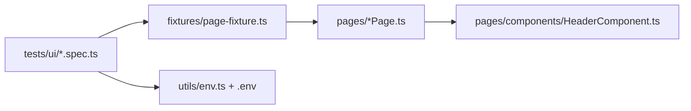

# CybersoftBnb – Playwright (TypeScript) UI Tests

Automated UI tests (Playwright + TypeScript) for https://demo5.cybersoft.edu.vn.
Run every command from the repository root (`CK_Nhom6_AirBNB`).

## 1. Setup (one time)

### 1.1. Requirements
- Node.js 18 or later (check with `node -v`).
- Git.

### 1.2. Install dependencies and the browser
```bash
npm install
npx playwright install chromium
```

### 1.3. Create the `.env` file
Bash / Git Bash:
```bash
cp .env.example .env
```
PowerShell:
```powershell
Copy-Item .env.example .env
```

Open `.env` and fill in the values:

| Variable | Meaning |
|---|---|
| `BASE_URL` | Site URL, defaults to `https://demo5.cybersoft.edu.vn` |
| `LOGIN_EMAIL`, `LOGIN_PASSWORD` | Valid account used by the login, logout, booking and profile tests |
| `LOGIN_INVALID_EMAIL`, `LOGIN_INVALID_PASSWORD` | Wrong credentials for the failed-login test |
| `REGISTER_NAME`, `REGISTER_PASSWORD`, `REGISTER_PHONE` | Data typed into the register form (the phone is also used by the profile update test) |
| `REGISTER_EXISTING_EMAIL` | Email of a user that **already exists** on the site and is **different** from `LOGIN_EMAIL` |
| `REGISTER_BIRTHDAY` | Format `January 01, 2000` |
| `REGISTER_GENDER` | Text of the gender option in the dropdown, e.g. `Male` |

Notes:
- `.env` is listed in `.gitignore` and is never committed.
- The `LOGIN_EMAIL` account should have at least one booking, otherwise the "booking history is displayed" test fails. Running the booking test first creates one.

## 2. Running tests

### 2.1. Run everything
```bash
npm test
```
Same as `npx playwright test`. Runs headless with parallel workers.

Run everything with a visible browser:
```bash
npm run test:headed
```

### 2.2. Run one spec file

| Area | Command |
|---|---|
| Login | `npx playwright test tests/ui/login.spec.ts` |
| Register | `npx playwright test tests/ui/register.spec.ts` |
| Logout | `npx playwright test tests/ui/logout.spec.ts` |
| Home (search) | `npx playwright test tests/ui/home.spec.ts` |
| Rooms (room cards) | `npx playwright test tests/ui/rooms.spec.ts` |
| Room detail | `npx playwright test tests/ui/roomDetail.spec.ts` |
| Booking | `npx playwright test tests/ui/booking.spec.ts` |
| Profile | `npx playwright test tests/ui/profile.spec.ts` |

Add `--headed` to watch the browser, for example:
```bash
npx playwright test tests/ui/login.spec.ts --headed
```

Run several files at once:
```bash
npx playwright test tests/ui/home.spec.ts tests/ui/rooms.spec.ts tests/ui/roomDetail.spec.ts
```

### 2.3. Run a single test
By title (a part of the title is enough):
```bash
npx playwright test -g "login with a valid account"
npx playwright test tests/ui/booking.spec.ts -g "total price"
```
By line number in the file:
```bash
npx playwright test tests/ui/login.spec.ts:5
```

### 2.4. List tests without running them
```bash
npx playwright test --list
```

## 3. Debugging helpers

| Goal | Command |
|---|---|
| UI mode: step through tests, pick locators, rerun quickly | `npx playwright test --ui` |
| Step-by-step debugging with the Inspector | `npx playwright test tests/ui/login.spec.ts --debug` |
| Run tests one at a time (easier to watch, avoids shared-data clashes) | `npx playwright test --workers=1` |
| Retry failed tests twice | `npx playwright test --retries=2` |
| Stop at the first failure | `npx playwright test -x` |
| Rerun only the tests that failed last time | `npx playwright test --last-failed` |

Tip for the first run: use `--headed --workers=1` for each spec, fix any locator that fails, then run the full suite.

## 4. Reports

After each run Playwright writes an HTML report to `playwright-report/`.

Open the report:
```bash
npm run report
```
(same as `npx playwright show-report`). Click a failed test to see the error, the steps, the screenshot and the video.

Artifacts of failed tests are stored in `test-results/`:
- Screenshot: saved automatically on failure.
- Video: saved automatically on failure.
- Trace: only recorded on retry. To always record it:
  ```bash
  npx playwright test --trace on
  ```
  Open a trace:
  ```bash
  npx playwright show-trace test-results/<test-folder>/trace.zip
  ```

## 5. Type check
```bash
npm run typecheck
```

## 6. Project structure

```
pages/                  Page Objects (locators + actions)
  components/           Shared parts (header)
fixtures/               Page object fixtures, plus the pre-logged-in fixture (loggedInUser)
tests/ui/               Test files (*.spec.ts)
utils/                  env.ts (reads .env), dateHelper.ts (dates and prices)
data/files/             Files used by the avatar upload tests
constants/              Timeout constants
playwright.config.ts    Playwright configuration
.env / .env.example     Test data and accounts
```



Page objects hold locators and business actions only. Assertions stay in the specs.

## 7. Troubleshooting

| Symptom | Fix |
|---|---|
| `Missing environment variable ...` | `.env` is missing or incomplete, see section 1.3 |
| `Executable doesn't exist` | Browser not installed: `npx playwright install chromium` |
| Register test does not show "Email already exists" | `REGISTER_EXISTING_EMAIL` is not registered on the site yet |
| Gender cannot be selected | `REGISTER_GENDER` does not match the text in the dropdown |
| Many tests fail at the header/menu | The locators in `pages/components/HeaderComponent.ts` do not match the UI; use `--ui` to pick new ones |
| Date picker tests (register, booking) fail | Check the locators in `RegisterPage.ts` / `BookingPage.ts` with `--headed` or `--ui` |
| Tests fail in parallel but pass alone | They share one account; try `--workers=1` |

## 8. Notes
- The tests run against a shared demo site with a shared account: profile update and booking tests change real data.
- Booking dates are computed from today (+30 and +37 days) so they never expire.
- The "same-day booking" test only asserts that no success notice appears; tighten it once the expected message is confirmed.

## 9. CI (GitHub Actions)
`.github/workflows/ci.yml` runs on push and on pull requests to `main`. Add every variable of `.env.example` (except `BASE_URL`) under **Settings → Secrets and variables → Actions**. The report is uploaded as the `playwright-test-results` artifact.
